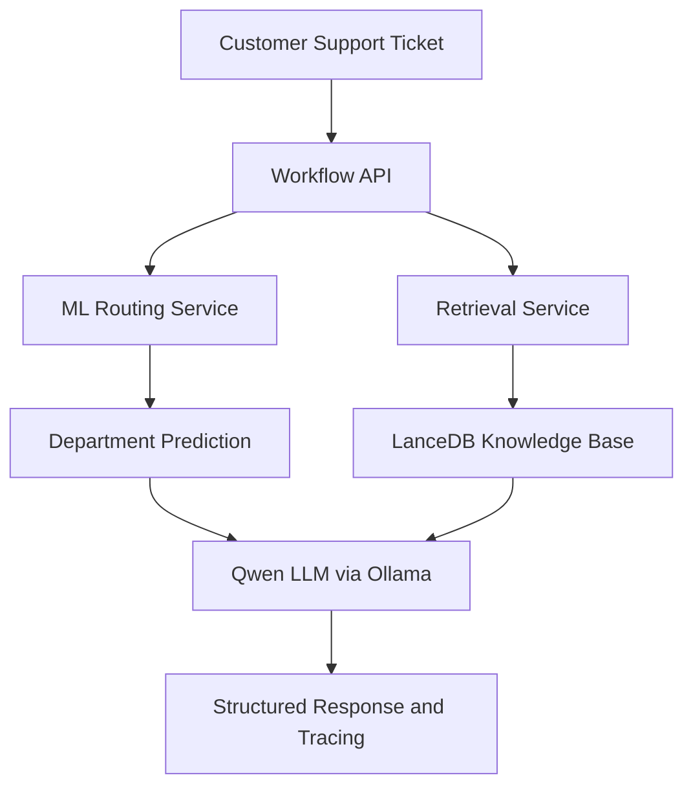

# AI-Powered Customer Support Ticket System

An end-to-end AI system for automated customer support ticket classification, knowledge-base retrieval, and LLM-powered summarization.

The system combines machine learning, retrieval-augmented generation (RAG), FastAPI microservices, Ollama, and Docker Compose.

## Architecture

## Key Features

- **Automated ticket classification:** Uses a trained Scikit-learn model to predict the appropriate support department and return classification scores.
- **Semantic knowledge retrieval:** Uses FastEmbed and LanceDB to retrieve relevant support articles.
- **LLM-powered summarization:** Uses Qwen 2.5 through Ollama to generate ticket summaries, identify customer requests, and highlight missing information.
- **Workflow orchestration:** Coordinates the routing, retrieval, and LLM services through a FastAPI-based workflow.
- **Structured API responses:** Returns department predictions, retrieved evidence, generated summaries, workflow status, and trace identifiers.
- **Request tracing:** Uses correlation identifiers and structured JSONL logs to track workflow execution.
- **Containerized deployment:** Runs four integrated services using Docker Compose, with health checks and persistent storage.

## Technology Stack

| Component | Technologies |
|---|---|
| Machine Learning | Python, Scikit-learn |
| Semantic Retrieval | FastEmbed, LanceDB |
| Large Language Model | Qwen 2.5 1.5B Instruct |
| LLM Serving | Ollama |
| API Development | FastAPI, Uvicorn |
| Workflow Orchestration | Python, HTTP service communication |
| Containerization | Docker, Docker Compose |
| Testing | Python, Requests |
| Observability | Structured JSONL logs, trace identifiers |

## Project Structure

| Directory | Description |
|---|---|
| `routing-service/` | Trained ML classifier and routing API |
| `retrieval-service/` | Knowledge-base embeddings, LanceDB, and retrieval API |
| `llm-service/` | Ollama model setup and documentation |
| `workflow-service/` | Workflow orchestration, HTTP clients, prompts, and tracing |
| `deployment/` | Docker Compose configuration and deployment instructions |
| `tests/` | Synthetic end-to-end integration test |

## Getting Started

### Prerequisites

- Docker Desktop with Docker Compose
- Python 3
- Python `requests` package for integration testing
- Sufficient memory and disk space to run the Qwen model

### 1. Clone the Repository

    git clone https://github.com/NanaMaryamMunagah/ai-support-ticket-system.git
    cd ai-support-ticket-system

Replace `NanaMaryamMunagah` with your GitHub username.

### 2. Set Up the LLM

    sh llm-service/ollama_setup.sh

This starts Ollama through Docker Compose and downloads the Qwen 2.5 model into a persistent Docker volume.

### 3. Start the Application

    docker compose -f deployment/compose.yaml up --build -d

### 4. Check Service Health

    docker compose -f deployment/compose.yaml ps

All four services should report healthy.

### 5. Run the Integration Test

    python -m pip install requests
    python tests/test_deployment.py

The test sends a synthetic support ticket through the complete workflow and validates the response.

### 6. Stop the Application

    docker compose -f deployment/compose.yaml down

## API Usage

The workflow API accepts customer support tickets through `POST /tickets/process`.

### Example Request

    curl -X POST http://localhost:8000/tickets/process \
      -H "Content-Type: application/json" \
      -d '{
        "ticket_id": 10001,
        "Body": "My television screen flickers intermittently. I have checked the HDMI cable and restarted the device, but the issue continues."
      }'

### Response

The API returns a structured JSON response containing:

- Predicted support department and classification scores
- Generated ticket summary and customer request
- Missing information identified by the LLM
- Retrieved knowledge-base evidence
- Workflow status, record ID, and trace ID
- Error information when processing fails

### API Documentation

FastAPI provides interactive documentation at `http://localhost:8000/docs` when the application is running.

## Testing and Validation

The system was tested using a synthetic customer support ticket and a four-service Docker Compose deployment.

The end-to-end integration test passed, validating:

- Successful ticket processing across the integrated services
- Expected workflow response fields and terminal status
- Department predictions and classification scores
- Retrieved knowledge-base evidence structure
- Generated summary and missing-information structure
- Valid workflow and trace identifiers
- Successful completion without workflow errors

The integration test is available in `tests/test_deployment.py`.

## Data and Model

The routing classifier was trained using a course-provided support-ticket dataset. The retrieval knowledge base contains course-provided support articles.

These materials were provided for educational use, with permission for public redistribution.

The repository includes the trained classifier and prepared retrieval records to support reproducible deployment.

## Limitations and Future Improvements

- The system is a portfolio prototype rather than a production customer-support platform.
- LLM-generated summaries should be reviewed before use in customer-facing decisions.
- Classification performance may vary across ticket categories and datasets.
- Local inference performance depends on available hardware resources.
- Production deployment would require authentication, access controls, monitoring, and additional security safeguards.

## Acknowledgments

Developed as part of an AI Engineering course and organized into an end-to-end portfolio project.

The course-provided training dataset and knowledge-base materials are acknowledged as supporting resources.

